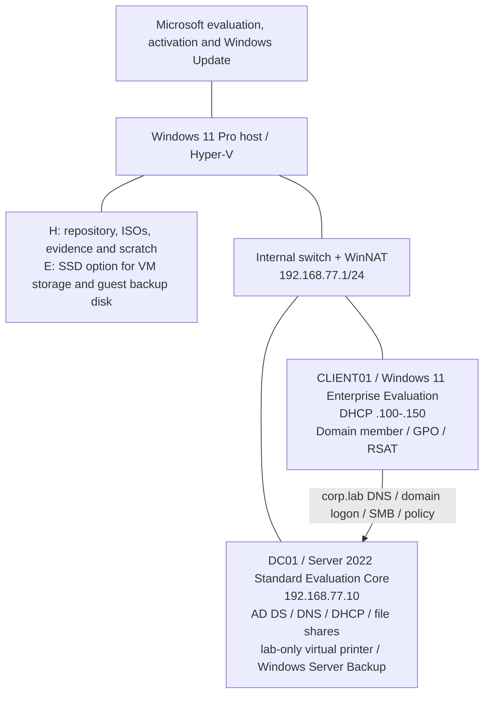

# Windows Active Directory Support Lab

A Windows Server 2022 and Windows 11 evaluation lab with automated Active Directory administration, Group Policy, file services and support troubleshooting.

## Project overview

| Area | What to look for |
| --- | --- |
| **Problem addressed** | Repeated account administration and desktop access faults need consistent procedures, scoped permissions and observable results. |
| **Implemented work** | Built a real Microsoft AD DS forest with DNS/DHCP, department OUs and groups, CSV identity workflows, file shares, eight GPOs, a domain-joined client, object recovery and a System State backup. Moved VM storage to a data SSD after diagnosing guest I/O delays. |
| **Skills demonstrated** | Windows Server, Active Directory, PowerShell, Group Policy, DNS, DHCP, AGDLP, NTFS/share permissions, backup and systematic troubleshooting. |
| **Demo** | [Actual machine evidence](evidence/README.md) is available. The onboarding and client-policy GIF is pending; no completed demonstration is claimed yet. |
| **How to use it** | Follow the [build guide](docs/build-guide.md), then the [identity workflow](#identity-workflow) and [operations guide](docs/operations.md). Preview changes with `-WhatIf`; verify outcomes inside the guests. |
| **Verification** | [10 live server checks](evidence/server/server-with-client-acceptance.json) passed, alongside [27 offline tests and static analysis](evidence/local-validation.json). Client policy, RSAT and ticket acceptance remain separate outstanding checks. |

**Build status:** DC01 is configured with Windows Server 2022 Evaluation and the `corp.lab` forest. Fictional onboarding/offboarding, a Recycle Bin restore and a System State backup have been executed. CLIENT01 runs Windows 11 Enterprise Evaluation, has joined `corp.lab`, received a DHCP lease and passed a secure-channel check. Both VMs now use the E: SSD; the repository, ISOs and evidence remain on H:. Policy results, RSAT, worked tickets and the demo remain incomplete. See [server evidence](evidence/server/README.md), [client checks](evidence/client/README.md) and the [verification register](evidence/README.md). Offline mocked tests are reported separately from guest acceptance checks.

[PowerShell CI](https://github.com/iamnajib71/windows-ad-lab/actions/workflows/ci.yml) runs static analysis and the offline tests. [Current deployment state and next steps](docs/current-state.md) records the real installation blocker.

## Architecture



This is the deployed infrastructure topology; client policy and troubleshooting evidence remain in progress. The internal switch is not bridged to the home LAN. DHCP is provided only by DC01 inside this subnet. NAT supplies outbound access for activation and updates without a second NIC on the DC. No inbound port forwarding is created.

## Capabilities and verification

| Keyword | Implementation | Evidence to collect |
| --- | --- | --- |
| Active Directory / Windows Server | Real Microsoft AD DS forest `corp.lab`, fictional accounts, OU design and domain join | ADUC, `Get-ADDomain`, CLIENT01 membership |
| Group Policy | Domain password/lockout policy, department drive preferences, printer preferences, desktop restrictions, Windows Update, LLMNR off and SMB signing required | GPMC, user/computer `gpresult`, effective registry and client behaviour |
| DNS / DHCP | AD-integrated DNS and reverse zone, authorised DHCP scope and DNS options | SRV lookup, lease and `ipconfig /all` |
| PowerShell | CSV onboarding, password reset, unlock, leavers, group changes, stale accounts; `-WhatIf` and Pester | Local/CI test results plus real account transcript |
| RSAT | ADUC, GPMC and DNS management from CLIENT01 | Three client console screenshots |
| NTFS permissions / file services | AGDLP, department Modify permissions, private home ACLs, access-based enumeration | `Get-Acl`, `Get-SmbShareAccess`, positive/negative access tests |
| Backup / recovery | Recycle Bin object restore and System State backup | Matching object GUID before/after; successful `wbadmin` catalogue |
| IT support / troubleshooting | Five reproducible ticket runbooks | Before, diagnostic and after screenshots/transcripts for every ticket |

## Start here

Read [the build guide](docs/build-guide.md), [operations](docs/operations.md), [policy and permissions](docs/policy-and-permissions.md), and [backup/recovery](docs/recovery.md). Host scripts require **elevated Windows PowerShell 5.1**; run guest scripts only inside the named VM. PowerShell 7 is used for local tests and CI.

The repository, ISOs, evidence and scratch files live under `H:\My Projects - IT\windows-ad-lab`. VM storage starts under `.lab` and can be moved to the dedicated SSD directory `E:\WindowsADLab` using the guarded Hyper-V storage script. Guest paths such as `C:\LabData` remain inside those virtual disks. Windows, Hyper-V binaries, event logs and normal host paging may still use C:. Lab scripts do not relocate the host page file or change global Hyper-V defaults.

VM memory is capped at 2 GiB for DC01 and 4 GiB for CLIENT01. Startup checks retain at least 2 GiB of free host RAM; close other memory-heavy applications before running both guests.

```powershell
# After completing and verifying both Microsoft evaluation ISO downloads:
.\scripts\host\Invoke-LabBuild.ps1 -Stage Prepare -WhatIf
.\scripts\host\Invoke-LabBuild.ps1 -Stage Prepare
# Close other VMs/apps to provide at least 8 GiB free RAM, then:
.\scripts\host\Invoke-LabBuild.ps1 -Stage Configure
```

Prepare creates powered-off Generation 2 VMs with Secure Boot and vTPM, attaches the official evaluation ISOs plus private unattended setup media, and stores random local/DSRM credentials as Windows DPAPI-protected CLIXML under an ACL-protected ignored directory. **Windows Setup runs inside each VM and targets only that guest's virtual disk. No host boot-repair or physical-disk partitioning tools are used in the current workflow.** Configure boots the guests, waits for setup, then uses PowerShell Direct to install the forest, OUs, DHCP, shares, policy and RSAT and join CLIENT01. Reboots and first-boot setup take time. A failed stage needs inspection; scripts do not silently delete or overwrite partially built VMs. DC01 and CLIENT01 are installed and domain membership is verified; the client management-tools installation is still in progress.

## Identity workflow

Run on DC01 with the ActiveDirectory module. The sample CSV contains fictional users only. Address attributes use the reserved `.invalid` suffix; **there is no Exchange/mailbox provisioning or mail delivery**.

```powershell
$initialPassword = Read-Host 'Temporary fictional-user password (14+ characters)' -AsSecureString
.\scripts\identity\New-LabUser.ps1 -CsvPath .\data\onboarding.csv -InitialPassword $initialPassword -WhatIf
.\scripts\identity\New-LabUser.ps1 -CsvPath .\data\onboarding.csv -InitialPassword $initialPassword
.\scripts\identity\Unlock-LabUser.ps1 -Identity alex.morgan -WhatIf
$replacementPassword = Read-Host 'New temporary password' -AsSecureString
.\scripts\identity\Reset-LabUserPassword.ps1 -Identity alex.morgan -NewPassword $replacementPassword -WhatIf
.\scripts\identity\Update-LabGroups.ps1 -CsvPath .\data\group-changes.csv -WhatIf
.\scripts\identity\Export-LabStaleUsers.ps1 -InactiveDays 90 -OutputPath C:\LabEvidence\stale.csv -WhatIf
.\scripts\identity\Disable-LabUser.ps1 -Identity alex.morgan -WhatIf
```

Remove `-WhatIf` after reviewing each plan. Leavers require confirmation, are disabled first, lose direct group memberships, and move to `OU=Disabled`. Their home folders remain for review. Onboarding validates the full CSV and existing-account/group/OU conflicts before its first write. It starts accounts disabled and enables only after home ACLs and membership succeed. This is not a transaction: earlier completed users remain if a later operation fails. Stale-account reports use replicated `LastLogonDate` and are approximate; no accounts are automatically disabled from that report.

## Five support tickets

These are executable runbooks awaiting real execution evidence, **not completed incident claims**.

| Ticket | Troubleshooting focus | Status |
| --- | --- | --- |
| [01: Locked-out user](docs/tickets/01-locked-out-user.md) | Lockout state, 4740 event, caller computer, unlock and password hygiene | Pending live execution |
| [02: Wrong drive mapping](docs/tickets/02-wrong-drive-mapping.md) | Group token, GPP target, UNC and drive letter | Pending live execution |
| [03: GPO not applying](docs/tickets/03-gpo-not-applying.md) | OU scope, link, `gpresult`, `gpupdate`, effective setting | Pending live execution |
| [04: Computer trust failure](docs/tickets/04-computer-trust.md) | DNS/time, secure channel and machine password repair | Pending live execution |
| [05: Share access denied](docs/tickets/05-share-access.md) | AGDLP, share/NTFS intersection and refreshed user token | Pending live execution |

## Validation

CI runs PSScriptAnalyzer 1.24.0 and Pester 5.7.1 on a Windows runner with **no domain**. Tests cover CSV rejection, domain/OU scope, no-write `-WhatIf`, password flags, offboarding, stale-account boundaries, successful onboarding orchestration and failure handling. Host deployment, SYSVOL preferences, DHCP, printer drivers, actual ACL enforcement and Windows Update require integration verification in the guests.

```powershell
Import-Module Pester -RequiredVersion 5.7.1
Invoke-Pester -Path .\tests -Output Detailed
Import-Module PSScriptAnalyzer -RequiredVersion 1.24.0
Invoke-ScriptAnalyzer -Path .\scripts -Recurse -Settings .\PSScriptAnalyzerSettings.psd1
Invoke-ScriptAnalyzer -Path .\src -Recurse -Settings .\PSScriptAnalyzerSettings.psd1
```

## Honest limits

- Lab scale: one DC and one client, no redundant DC, replication, multi-site topology or production workload.
- **Evaluation software only**: [Server 2022 evaluation](https://www.microsoft.com/en-us/evalcenter/download-windows-server-2022) is time limited to 180 days; [Windows 11 Enterprise evaluation](https://www.microsoft.com/en-us/evalcenter/download-windows-11-enterprise) to 90 days. No product keys, paid licences or activation workarounds are supplied. Follow Microsoft's activation requirements.
- No production change management, SLA, customer data, enterprise monitoring, disaster recovery certification or claim of production experience.
- AD DS, DHCP, files and a virtual print queue share a DC to fit the lab. Running Print Spooler and user file services on a DC is a lab compromise. The printer discards output and does not demonstrate a physical device.
- The SMB-signing/LLMNR settings are a focused exercise, not a complete Microsoft security baseline. Legacy Windows Update policy effectiveness and printer behaviour must be checked on the downloaded client build.
- The backup disk shares the same physical H: drive as the guests. It demonstrates System State commands, not protection against host/disk loss. Checkpoints are not AD backups.
- No Entra ID, Intune, hybrid identity or Microsoft 365 administration is demonstrated here.
- Committed server results are actual guest outputs. Client, ticket and demo evidence remains pending; no simulated recordings are presented as live results.

MIT licence. Commit identity: Nazmul Hassan.
