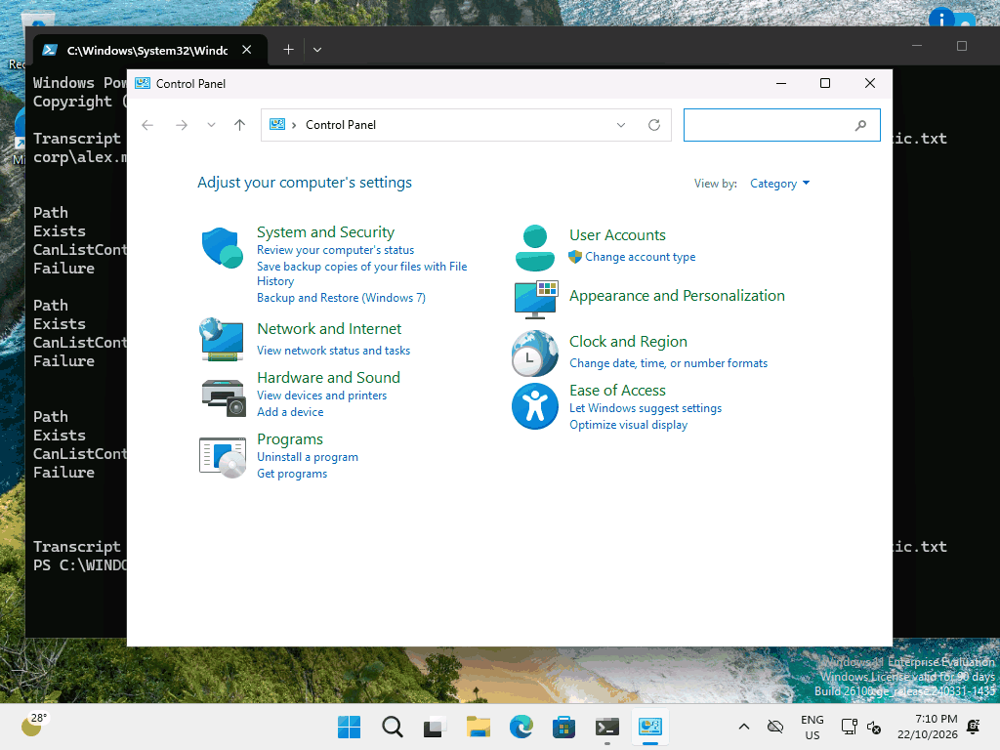
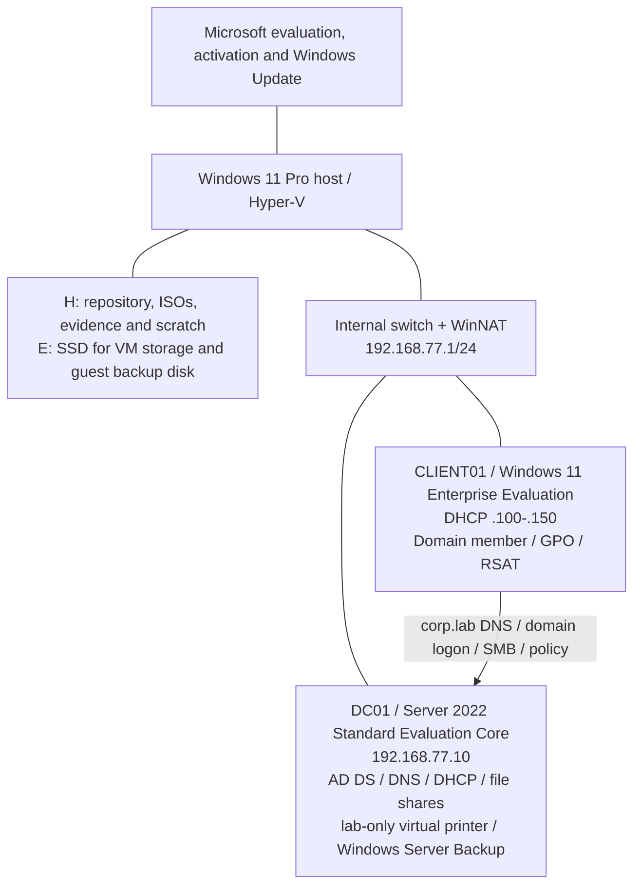

# Windows Active Directory Support Lab

I built a Windows office lab where staff accounts, shared drives and desktop policies are managed centrally, and documented how I diagnosed and repaired common support faults.



[PowerShell CI](https://github.com/iamnajib71/windows-ad-lab/actions/workflows/ci.yml) · [MIT licence](LICENSE)

## At a glance

| Area | Evidence-backed summary |
| --- | --- |
| **The problem** | In this simulated office, new starters depend on an administrator to create accounts and grant folder access; locked accounts and incorrect drive mappings interrupt staff work and consume support time. |
| **What I built** | I configured a Microsoft domain, automated fictional staff onboarding and leavers, applied desktop policies and group-based permissions (AGDLP), and verified access as a standard user. |
| **Results** | [27 offline tests with zero analysis findings](evidence/local-validation.json), [10 live server checks](evidence/server/server-with-client-acceptance.json) and [6 standard-user checks](evidence/client/client-staff-acceptance.json) passed. [Five deliberately reproduced faults were repaired](docs/current-state.md). |
| **Skills shown** | Active Directory, Windows Server, Group Policy, PowerShell, DNS, DHCP, NTFS permissions, RSAT, backup and troubleshooting. |
| **Relevant roles** | Service Desk Analyst, Desktop Support, Junior Systems Administrator. |
| **How it was built** | Designed, specified and reviewed by me; built with Codex as my coding agent (vibe coding). Verification and its limits are linked below. |
| **Try it / evidence** | [Demo and provenance](evidence/client/README.md#demo) · [Build guide](docs/build-guide.md) · [Learning walkthrough](docs/learning-walkthrough.md) · [Evidence register](evidence/README.md) |

## What I did, step by step

1. Planned an isolated office network so lab DHCP would not affect the home network; recorded the [topology and build order](docs/learning-walkthrough.md#2-build-order-and-why-it-matters).
2. Installed the server and client, then configured the directory, DNS and DHCP before joining the client to the domain.
3. Created departments, security groups and shared folders before using the [identity workflow](#identity-workflow) to onboard fictional staff.
4. Applied Group Policy for drives, desktop restrictions and the lab printer, then checked the result as a standard user.
5. Reproduced and repaired the [support tickets](#five-support-tickets), checking the observed behaviour before and after each repair.
6. Restored a deleted directory object, completed a System State backup and recorded [acceptance evidence](docs/current-state.md); kept mocked tests separate from live checks.

## Problems I hit and how I solved them

- **Guest disk operations stalled:** moved the VM storage to an SSD and verified the relocation. [Build delays and storage evidence](docs/learning-walkthrough.md#11-lessons-from-the-builds-delays).
- **RSAT installation failed through a PowerShell servicing call:** retried inside the client using a SYSTEM task, then checked installed capabilities and opened the actual consoles. [Recorded issue](docs/learning-walkthrough.md#11-lessons-from-the-builds-delays).
- **A path-existence check did not prove access:** changed the acceptance check to enumerate the folder and stop on errors, then verified both allowed and denied access. [Permission checks](docs/learning-walkthrough.md#8-test-permissions-by-doing-the-operation).

## Architecture



This is the deployed infrastructure topology. The internal switch is not bridged to the home LAN. DHCP is provided only by DC01 inside this subnet. NAT supplies outbound access for activation and updates without a second NIC on the DC. No inbound port forwarding is created.

## Capabilities and verification

| Keyword | Implementation | Verification |
| --- | --- | --- |
| Active Directory / Windows Server | Real Microsoft AD DS forest `corp.lab`, fictional accounts, OU design and domain join | ADUC, `Get-ADDomain`, CLIENT01 membership |
| Group Policy | Domain password/lockout policy, department drive preferences, printer preferences, desktop restrictions, Windows Update, LLMNR off and SMB signing required | GPMC, user/computer `gpresult`, effective registry and client behaviour |
| DNS / DHCP | AD-integrated DNS and reverse zone, authorised DHCP scope and DNS options | SRV lookup, lease and `ipconfig /all` |
| PowerShell | CSV onboarding, password reset, unlock, leavers, group changes, stale accounts; `-WhatIf` and Pester | Local/CI test results plus real account transcript |
| RSAT | ADUC, GPMC and DNS management from CLIENT01 | [Three actual console screenshots](evidence/client/README.md#rsat) |
| NTFS permissions / file services | AGDLP, department Modify permissions, private home ACLs, access-based enumeration | `Get-Acl`, `Get-SmbShareAccess`, positive/negative access tests |
| Backup / recovery | Recycle Bin object restore and System State backup | Matching object GUID before/after; successful `wbadmin` catalogue |
| IT support / troubleshooting | Five reproducible ticket runbooks | Before, diagnostic and after screenshots/transcripts for every ticket |

## Start here

Read [the build guide](docs/build-guide.md), [operations](docs/operations.md), [policy and permissions](docs/policy-and-permissions.md), and [backup/recovery](docs/recovery.md). Host scripts require **elevated Windows PowerShell 5.1**; run guest scripts only inside the named VM. PowerShell 7 is used for local tests and CI.

The repository, ISOs, evidence and scratch files live under `H:\My Projects - IT\windows-ad-lab`. VM storage starts under `.lab` and can be moved to the dedicated SSD directory `E:\WindowsADLab` using the guarded Hyper-V storage script. Guest paths such as `C:\LabData` remain inside those virtual disks. Windows, Hyper-V binaries, event logs and normal host paging may still use C:. Lab scripts do not relocate the host page file or change global Hyper-V defaults.

VM memory is capped at 2 GiB for DC01 and 4 GiB for CLIENT01. Startup checks retain at least 2 GiB of free host RAM; close other memory-heavy applications before running both guests.

```powershell
# After completing and verifying both Microsoft evaluation ISO downloads:
.\scripts\host\Invoke-LabBuild.ps1 -Stage Prepare -WhatIf
.\scripts\host\Invoke-LabBuild.ps1 -Stage Prepare
# Close other VMs/apps to provide at least 8 GiB free RAM, then:
.\scripts\host\Invoke-LabBuild.ps1 -Stage Configure
```

Prepare creates powered-off Generation 2 VMs with Secure Boot and vTPM, attaches the official evaluation ISOs plus private unattended setup media, and stores random local/DSRM credentials as Windows DPAPI-protected CLIXML under an ACL-protected ignored directory. **Windows Setup runs inside each VM and targets only that guest's virtual disk. No host boot-repair or physical-disk partitioning tools are used in the current workflow.** Configure boots the guests, waits for setup, then uses PowerShell Direct to install the forest, OUs, DHCP, shares, policy and RSAT and join CLIENT01. Reboots and first-boot setup take time. A failed stage needs inspection; scripts do not silently delete or overwrite partially built VMs. See the walkthrough for actual installation issues and verified recovery steps; do not rerun Prepare on the existing lab.

## Identity workflow

Run on DC01 with the ActiveDirectory module. The sample CSV contains fictional users only. Address attributes use the reserved `.invalid` suffix; **there is no Exchange/mailbox provisioning or mail delivery**.

```powershell
$initialPassword = Read-Host 'Temporary fictional-user password (14+ characters)' -AsSecureString
.\scripts\identity\New-LabUser.ps1 -CsvPath .\data\onboarding.csv -InitialPassword $initialPassword -WhatIf
.\scripts\identity\New-LabUser.ps1 -CsvPath .\data\onboarding.csv -InitialPassword $initialPassword
.\scripts\identity\Unlock-LabUser.ps1 -Identity alex.morgan -WhatIf
$replacementPassword = Read-Host 'New temporary password' -AsSecureString
.\scripts\identity\Reset-LabUserPassword.ps1 -Identity alex.morgan -NewPassword $replacementPassword -WhatIf
.\scripts\identity\Update-LabGroups.ps1 -CsvPath .\data\group-changes.csv -WhatIf
.\scripts\identity\Export-LabStaleUsers.ps1 -InactiveDays 90 -OutputPath C:\LabEvidence\stale.csv -WhatIf
.\scripts\identity\Disable-LabUser.ps1 -Identity alex.morgan -WhatIf
```

Remove `-WhatIf` after reviewing each plan. Leavers require confirmation, are disabled first, lose direct group memberships, and move to `OU=Disabled`. Their home folders remain for review. Onboarding validates the full CSV and existing-account/group/OU conflicts before its first write. It starts accounts disabled and enables only after home ACLs and membership succeed. This is not a transaction: earlier completed users remain if a later operation fails. Stale-account reports use replicated `LastLogonDate` and are approximate; no accounts are automatically disabled from that report.

## Five support tickets

These are deliberately reproduced faults in the disposable lab, with actual diagnosis and repair evidence. They do not represent customer incidents.

| Ticket | Troubleshooting focus | Status |
| --- | --- | --- |
| [01: Locked-out user](docs/tickets/01-locked-out-user.md) | Five failed authentications, 4740 event, scoped unlock | Correct password blocked → accepted |
| [02: Wrong drive mapping](docs/tickets/02-wrong-drive-mapping.md) | Group token, GPP target, UNC and drive letter | F: wrong HR target → Finance write/read |
| [03: GPO not applying](docs/tickets/03-gpo-not-applying.md) | OU scope, disabled link, `gpresult`, `gpupdate` | Restriction absent → enforced |
| [04: Computer trust failure](docs/tickets/04-computer-trust.md) | DNS/time, machine password and secure-channel repair | Secure channel False → True |
| [05: Share access denied](docs/tickets/05-share-access.md) | AGDLP and share/NTFS intersection | Finance denied → allowed; HR still denied |

## Validation

CI runs PSScriptAnalyzer 1.24.0 and Pester 5.7.1 on a Windows runner with **no domain**. Tests cover CSV rejection, domain/OU scope, no-write `-WhatIf`, password flags, offboarding, stale-account boundaries, successful onboarding orchestration and failure handling. Host deployment, SYSVOL preferences, DHCP, printer drivers, actual ACL enforcement and Windows Update require integration verification in the guests.

```powershell
Import-Module Pester -RequiredVersion 5.7.1
Invoke-Pester -Path .\tests -Output Detailed
Import-Module PSScriptAnalyzer -RequiredVersion 1.24.0
Invoke-ScriptAnalyzer -Path .\scripts -Recurse -Settings .\PSScriptAnalyzerSettings.psd1
Invoke-ScriptAnalyzer -Path .\src -Recurse -Settings .\PSScriptAnalyzerSettings.psd1
```

## Honest limits

- Lab scale: one DC and one client, no redundant DC, replication, multi-site topology or production workload.
- **Evaluation software only**: [Server 2022 evaluation](https://www.microsoft.com/en-us/evalcenter/download-windows-server-2022) is time limited to 180 days; [Windows 11 Enterprise evaluation](https://www.microsoft.com/en-us/evalcenter/download-windows-11-enterprise) to 90 days. No product keys, paid licences or activation workarounds are supplied. Follow Microsoft's activation requirements.
- No production change management, SLA, customer data, enterprise monitoring, disaster recovery certification or claim of production experience.
- AD DS, DHCP, files and a virtual print queue share a DC to fit the lab. Running Print Spooler and user file services on a DC is a lab compromise. The printer discards output and does not demonstrate a physical device.
- The SMB-signing/LLMNR settings are a focused exercise, not a complete Microsoft security baseline. Windows Update registry configuration was verified; a full update/restart cycle was not demonstrated. One printer preference refresh reported 0x8007000a; subsequent refreshes and final acceptance showed the printer connected. No root-cause fix for that transient error is claimed.
- The backup disk shares the same physical E: SSD as the guests. It demonstrates System State commands, not protection against host/disk loss. No System State restore was performed. Checkpoints are not AD backups.
- No Entra ID, Intune, hybrid identity or Microsoft 365 administration is demonstrated here.
- Committed results and the GIF come from the actual guests. Ticket 01/04 screenshots and the readable ticket-05 summary are clearly labelled reviews of recorded before/after output, not live sign-in error screens. The [evidence register](evidence/README.md) explains provenance and historical installation records.

MIT licence. Commit identity: Nazmul Hassan.

## Built by Nazmul Hassan

[LinkedIn](https://www.linkedin.com/in/iamnajib71) · [GitHub](https://github.com/iamnajib71)
