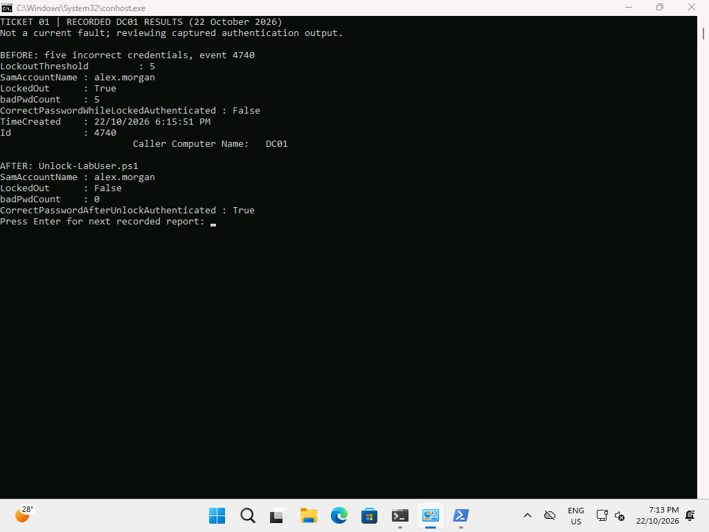

# Ticket 01 — Locked-out fictional user

**Resolved, 22 October 2026.** Five deliberately incorrect authentications locked CORP\alex.morgan at 18:15:51. Correct credentials were rejected while locked; the scripted unlock at 18:29 restored successful authentication. This was a controlled DC01 authentication exercise, not a customer incident or captured Windows sign-in error.

## Reproduce

On DC01, use the disposable Alex account only. The executed helper generated an incorrect random password privately, then used `System.DirectoryServices.AccountManagement.PrincipalContext.ValidateCredentials` five times. No password is published. The effective policy was threshold 5, duration/observation window 15 minutes. Do not repeatedly run the fault after lockout.

## Diagnose

```powershell
Get-ADDefaultDomainPasswordPolicy | Select-Object LockoutThreshold,LockoutDuration,LockoutObservationWindow
Get-ADUser alex.morgan -Properties LockedOut,badPwdCount,lockoutTime |
    Select-Object SamAccountName,LockedOut,badPwdCount,lockoutTime
Get-WinEvent -FilterHashtable @{LogName='Security';Id=4740;StartTime=(Get-Date).AddMinutes(-30)} |
    Select-Object TimeCreated,Id,Message
```

[Actual before output](../../evidence/server/ticket01-before.txt): five failed attempts, LockedOut=True, badPwdCount=5, correct-password authentication False. Event 4740 names Alex and caller DC01, matching the actual fault source. A disabled account or wrong password alone would not establish this diagnosis.

## Fix and verify

On DC01, from C:\LabRepo:

```powershell
Import-Module .\src\Lab.Identity.psm1 -Force
Unlock-LabUser -Identity alex.morgan -WhatIf
Unlock-LabUser -Identity alex.morgan
Get-ADUser alex.morgan -Properties LockedOut,badPwdCount |
    Select-Object SamAccountName,LockedOut,badPwdCount
```

[Actual after output](../../evidence/server/ticket01-after.txt): LockedOut=False, badPwdCount=0 and correct-password authentication True. The existing password was used through a protected credential; no reset or weakened policy was necessary. Alex later ran the [six passing client checks](../../evidence/client/client-staff-acceptance.json) in the actual interactive session.



This screenshot explicitly reviews saved DC01 outputs on CLIENT01. It is not a live sign-in-failure image.

## Prevent

Find and stop the source of repeated wrong credentials before repeated unlocks. Verify the caller's identity before account changes; distinguish unlock from reset. For this exercise the controlled fault loop was stopped. In a real environment inspect services, saved credentials and devices named by lockout events. Keep the threshold intact.
