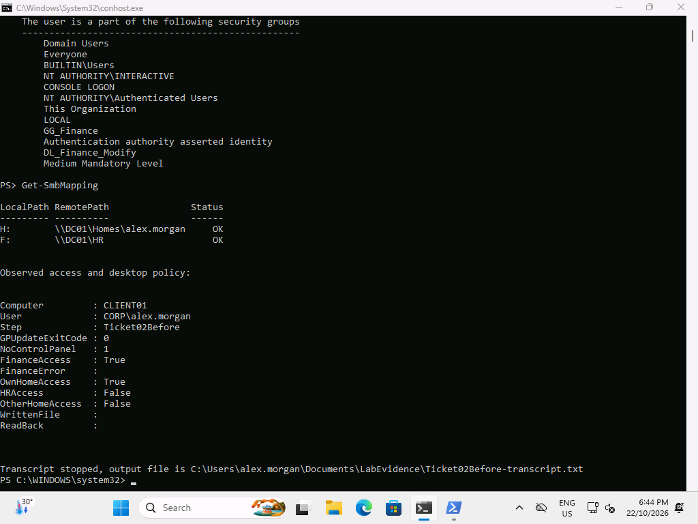
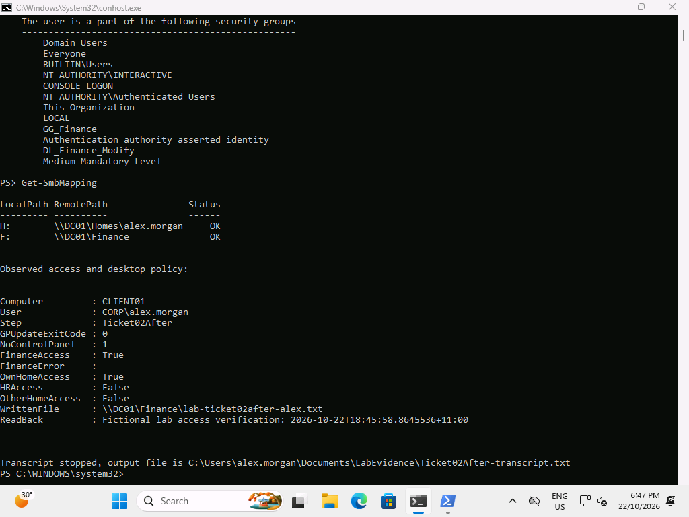

# Ticket 02 — Wrong department drive

**Resolved, 22 October 2026.** Alex's F: preference was deliberately changed from Finance to HR at 18:42. At 18:44 F: pointed to HR while direct Finance access still worked. The preference was corrected at 18:45; Alex then wrote and read a Finance test file.

## Reproduce

On DC01, open GPMC → LAB-Drive-Finance → User Configuration → Preferences → Windows Settings → Drive Maps. Change only F:'s target to `\\DC01\HR`; leave Finance group targeting intact. The actual helper edited that GPO's Drives.xml and incremented its user revision through `Set-GPRegistryValue`. [Server fault output](../../evidence/server/ticket02-before.txt).

On CLIENT01 as Alex run `gpupdate /target:user /force`. F: can show a mapping with status OK even when listing its destination is denied; mapping existence does not establish usable access.

## Diagnose

```powershell
whoami /groups
gpresult /scope user /r
Get-SmbMapping
Get-ChildItem F:\ -ErrorAction Stop
Get-ChildItem \\DC01\Finance -ErrorAction Stop
Get-ChildItem \\DC01\HR -ErrorAction Stop
```

Compare [before state](../../evidence/client/Ticket02Before-state.json) and [before gpresult](../../evidence/client/Ticket02Before-gpresult.txt). Alex has the Finance groups and Finance UNC access; the wrong target, rather than missing Finance permission, explains the drive fault.



## Fix and verify

Restore F:'s GPP target to `\\DC01\Finance`, preserving group targeting and permissions. Refresh user policy as Alex; inspect `Get-SmbMapping` and create/read only a fictional test file in Finance. [Server correction](../../evidence/server/ticket02-after.txt); [after state](../../evidence/client/Ticket02After-state.json); [transcript](../../evidence/client/Ticket02After-transcript.txt).



The screenshot captures the original 18:45 repair. The after-state JSON/transcript were recollected at 19:09 with the repaired target to record a plain-text readback after fixing evidence serialization; this was not another fault injection.

## Prevent

Check the drive letter, UNC target, GPO scope and group targeting together. Validate both expected department access and denial of unrelated departments after a policy change. Do not grant HR access to hide a Finance mapping mistake.
