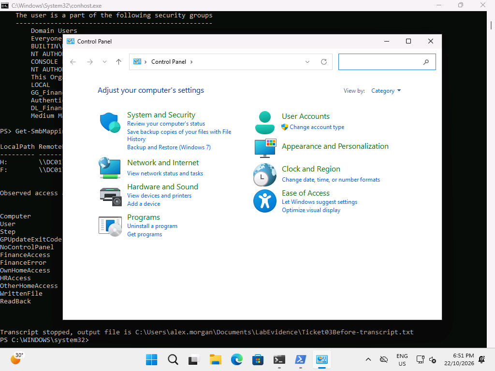
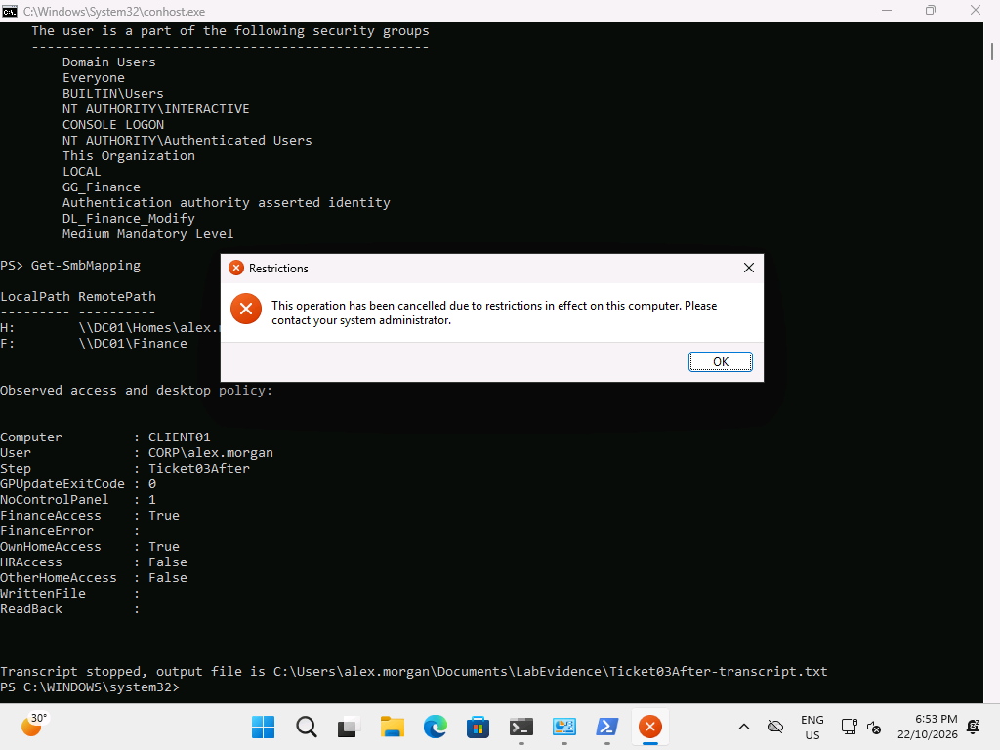

# Ticket 03 — Desktop restriction GPO not applying

**Resolved, 22 October 2026.** The Staff OU's LAB-Desktop-Restrictions link was deliberately disabled at 18:49. After refresh Alex could open Control Panel and NoControlPanel was absent. Re-enabling the link at 18:51 restored the restriction after refresh.

## Reproduce

On DC01 in this disposable lab only:

```powershell
Set-GPLink -Name LAB-Desktop-Restrictions -Target 'OU=Staff,DC=corp,DC=lab' -LinkEnabled No
```

On CLIENT01 as Alex: `gpupdate /target:user /force`, then try Control Panel. [Server fault output](../../evidence/server/ticket03-before.txt).

## Diagnose

```powershell
# CLIENT01, Alex
gpresult /scope user /r
Get-ItemProperty 'HKCU:\Software\Microsoft\Windows\CurrentVersion\Policies\Explorer' -Name NoControlPanel -ErrorAction SilentlyContinue
# DC01
Get-ADUser alex.morgan | Select-Object DistinguishedName
(Get-GPInheritance -Target 'OU=Staff,DC=corp,DC=lab').GpoLinks |
    Select-Object DisplayName,Enabled,Target
```

[Before gpresult](../../evidence/client/Ticket03Before-gpresult.txt) and [state](../../evidence/client/Ticket03Before-state.json) show the missing desktop restriction. Check OU placement and link state before changing registry values locally. Other working policies help narrow the fault.



## Fix and verify

```powershell
# DC01
Set-GPLink -Name LAB-Desktop-Restrictions -Target 'OU=Staff,DC=corp,DC=lab' -LinkEnabled Yes
# CLIENT01, Alex
gpupdate /target:user /force
gpresult /scope user /r
Get-ItemProperty 'HKCU:\Software\Microsoft\Windows\CurrentVersion\Policies\Explorer' -Name NoControlPanel
```

[Server repair](../../evidence/server/ticket03-after.txt); [after state](../../evidence/client/Ticket03After-state.json); [after gpresult](../../evidence/client/Ticket03After-gpresult.txt). NoControlPanel=1 and the Restrictions dialog demonstrate effective behavior, beyond the GPO merely existing.



## Prevent

Review links and target OUs with every GPO edit. Capture gpresult and effective behavior from a standard-user session. Use a test OU/group for broader policy changes; avoid bypassing the management source with local registry edits.
