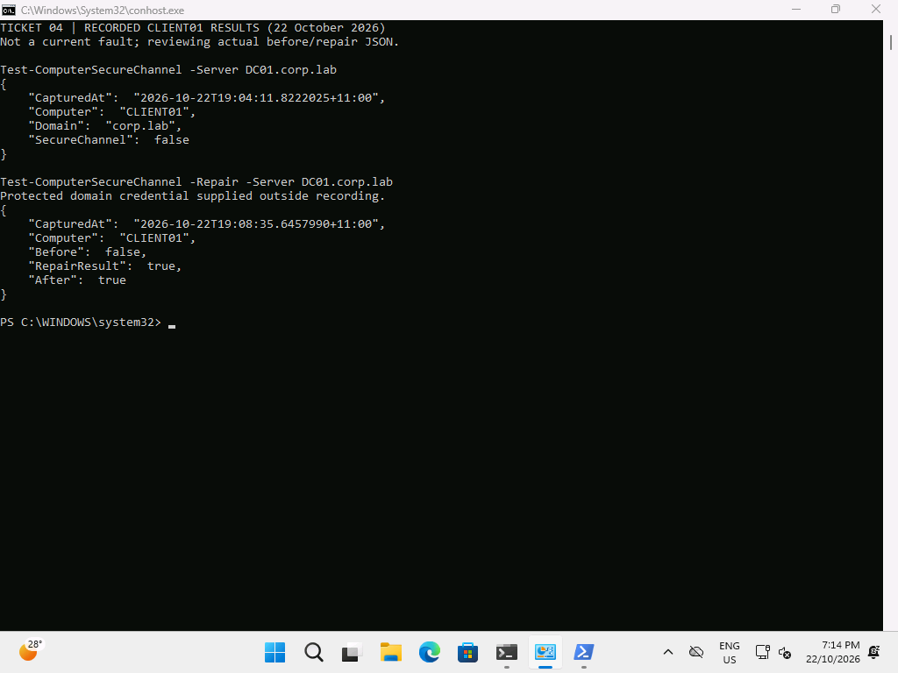

# Ticket 04 — Broken computer trust

**Resolved, 22 October 2026.** A guarded directory-side reset of CLIENT01$'s machine password at 19:04 deliberately desynchronised its secret. The actual client secure-channel check returned False. Scoped repair at 19:08 returned True, followed by a True verification. No DC rollback or remove/rejoin was needed.

## Reproduce

Retain the protected CLIENT01\LabAdmin local recovery credential before changing the disposable machine account. On DC01, verify the exact managed computer DN, then reset only that machine password using a private SecureString:

```powershell
Get-ADComputer CLIENT01 | Select-Object Name,DistinguishedName
$temporaryMachinePassword=Read-Host 'Temporary lab machine password' -AsSecureString
Set-ADAccountPassword -Identity 'CLIENT01$' -Reset -NewPassword $temporaryMachinePassword
```

[Actual server fault output](../../evidence/server/ticket04-before.txt). Previous machine secrets and caching can affect results: always inspect the actual channel before claiming a fault. In this run no client reboot was required to observe False.

## Diagnose

On CLIENT01 in an elevated **local** administrative guest session:

```powershell
Get-CimInstance Win32_ComputerSystem | Select-Object Name,Domain,PartOfDomain
Resolve-DnsName _ldap._tcp.dc._msdcs.corp.lab -Type SRV
w32tm /query /status
Test-ComputerSecureChannel -Server DC01.corp.lab -Verbose
```

[Before JSON](../../evidence/client/Ticket04-before-client.json) records False at 19:04:11. The [captured diagnostic output](../../evidence/client/ticket04-diagnostics-output.txt) preserves DNS/time inspection; the [guest transcript](../../evidence/client/Ticket04-before-client.txt) records the verbose broken-channel result. Time output reported the Hyper-V time provider and a not-synchronised leap indicator; this exercise does not claim a complete time-service health validation. The deliberate secret reset and successful scoped repair establish the demonstrated fault.

## Fix and verify

```powershell
$repairCredential=Get-Credential 'CORP\Administrator'
Test-ComputerSecureChannel -Repair -Server DC01.corp.lab -Credential $repairCredential -Verbose
Test-ComputerSecureChannel -Verbose
```

[Repair JSON](../../evidence/client/Ticket04-secure-channel.json): Before=False, RepairResult=True, After=True. [Captured repair output](../../evidence/client/ticket04-repair-output.txt). Subsequent [standard-user acceptance](../../evidence/client/client-staff-acceptance.json) and [live demo](../../evidence/client/demo.gif) completed successfully. A fresh post-repair Windows sign-in error/recovery sequence was not recorded; the evidence is the actual machine secure-channel repair.



This is an explicitly labelled review of captured JSON, not a live logon-failure screen. The repair credential is not included.

## Prevent

Avoid uncontrolled computer-account resets, duplicate computer names and reverting domain members to stale snapshots. Keep a local recovery account available. Separate DNS, time and machine-secret diagnosis; repair only the affected member. Do not use this member-client repair procedure on a DC.
