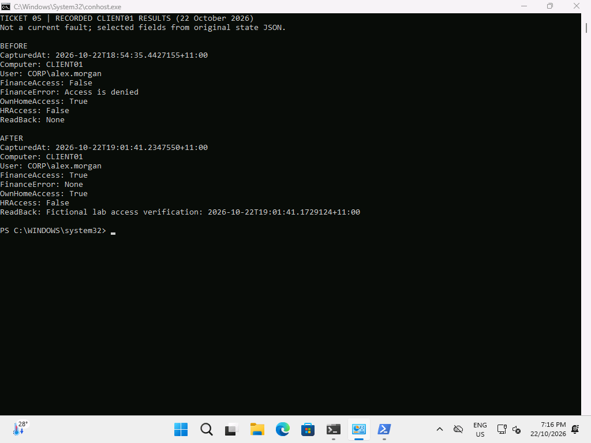
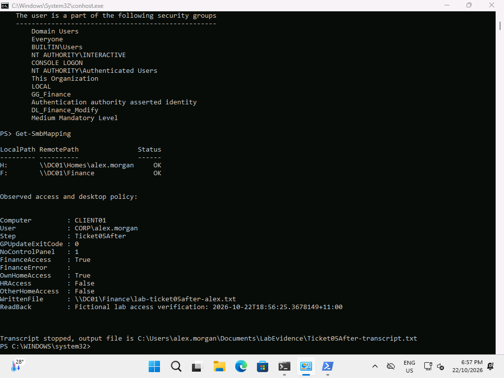

# Ticket 05 — Finance share access denied

**Resolved, 22 October 2026.** At 18:54 the Finance domain-local group's share Change grant was deliberately revoked. Group nesting and NTFS Modify remained intact. Alex received Access is denied for Finance while the own home still worked. Restoring only the share grant at 18:55 restored Finance write/read access.

## Reproduce

On DC01, verify Finance points to C:\LabData\Finance. In the disposable lab only:

```powershell
Get-SmbShare Finance | Select-Object Name,Path
Revoke-SmbShareAccess -Name Finance -AccountName 'CORP\DL_Finance_Modify' -Force
Get-SmbSession | Where-Object ClientUserName -eq 'CORP\alex.morgan' | Close-SmbSession -Force
```

Closing only Alex's lab SMB sessions forces a fresh share access check. Do not close unrelated sessions. [Actual server fault output](../../evidence/server/ticket05-before.txt).

## Diagnose

```powershell
# CLIENT01, Alex
whoami /groups
Get-SmbMapping
Get-ChildItem \\DC01\Finance -ErrorAction Stop
Get-ChildItem \\DC01\Homes\alex.morgan -ErrorAction Stop
# DC01
Get-SmbShareAccess Finance
(Get-Acl C:\LabData\Finance).Access | Format-Table
Get-ADGroupMember GG_Finance
Get-ADGroupMember DL_Finance_Modify
```

[Before state](../../evidence/client/Ticket05Before-state.json) records FinanceAccess=False with Access is denied, while OwnHomeAccess=True. The server record preserves intact NTFS/group configuration. Share and NTFS permissions intersect; a correct NTFS grant cannot compensate for the missing share grant.

## Fix and verify

```powershell
# DC01
Grant-SmbShareAccess -Name Finance -AccountName 'CORP\DL_Finance_Modify' -AccessRight Change -Force
Get-SmbSession | Where-Object ClientUserName -eq 'CORP\alex.morgan' | Close-SmbSession -Force
# CLIENT01, Alex
Get-ChildItem \\DC01\Finance -ErrorAction Stop
```

[Server correction](../../evidence/server/ticket05-after.txt); [after state and readback](../../evidence/client/Ticket05After-state.json); [after transcript](../../evidence/client/Ticket05After-transcript.txt). HR/another home remain inaccessible. The original repair screenshot is 18:56; JSON was recollected at 19:01 after correcting plain-text evidence serialization.



The summary explicitly reviews saved results, rather than presenting the historical fault as current.



## Prevent

Manage resource permissions through the domain-local groups and verify both share and NTFS layers. Test with the affected standard user, including a negative department check. Avoid Everyone:FullControl, direct per-user department grants or disabling ABE to bypass diagnosis.
