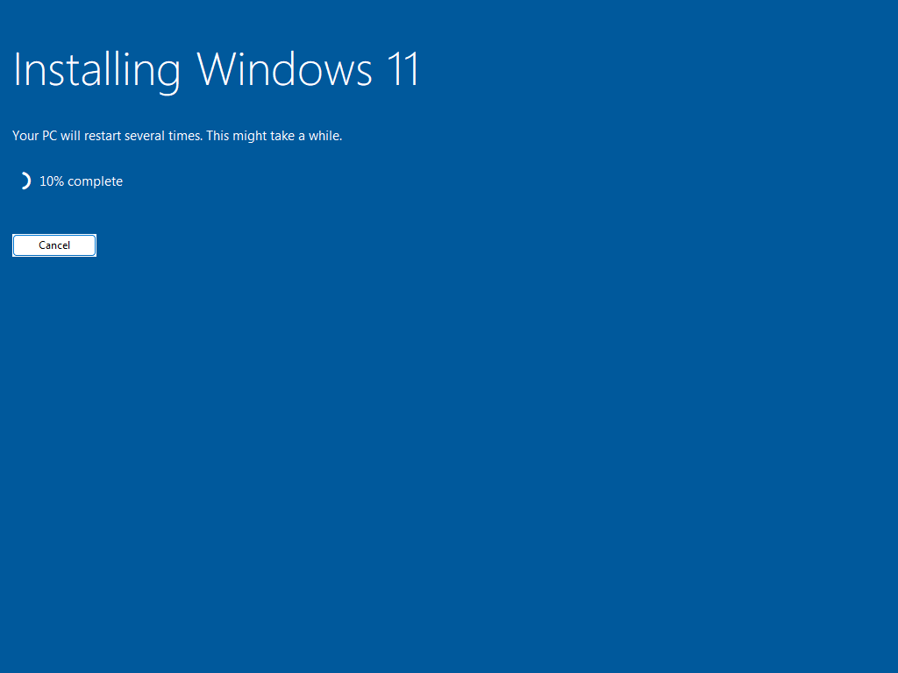

# Actual CLIENT01 setup evidence

Captured on 22 October 2026 from CLIENT01's real Hyper-V framebuffer at 1024 × 768. The screenshot contains the Windows 11 installer inside the guest; host desktop content is excluded. Pixels have not been edited.

This records installation in progress. It does not establish successful first boot, evaluation activation, domain membership or effective Group Policy. Those checks remain pending.

[SHA256 manifest](sha256.csv) hashes the published PNG bytes.
