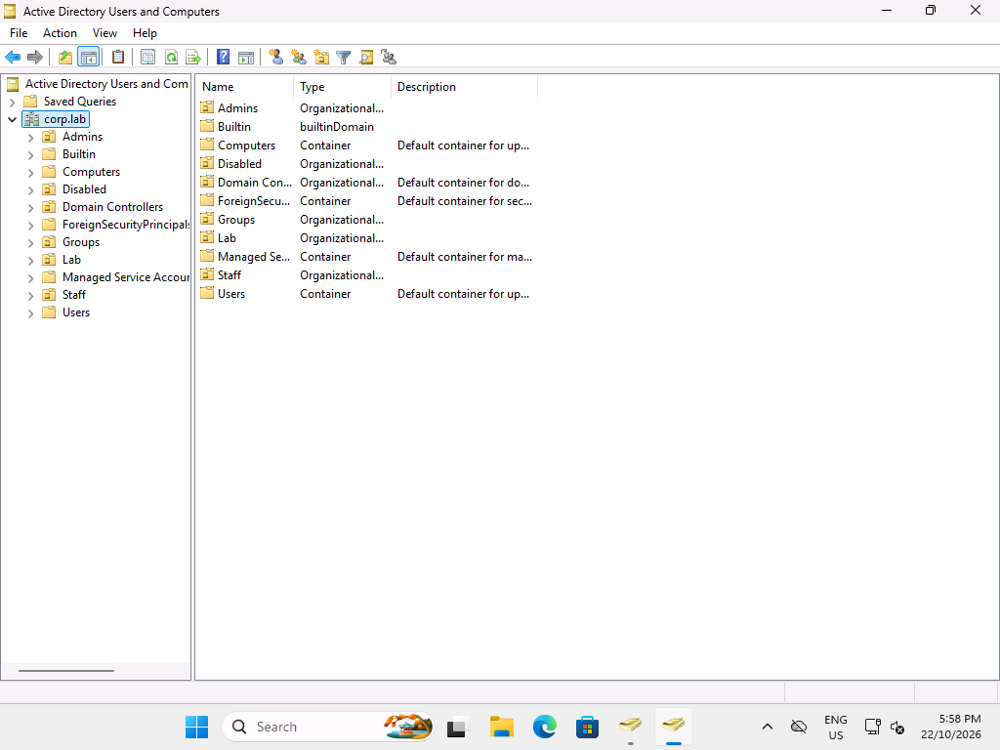
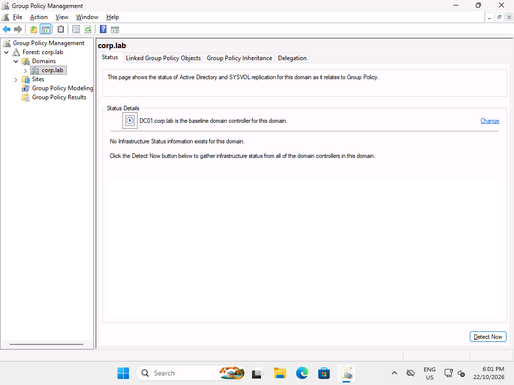
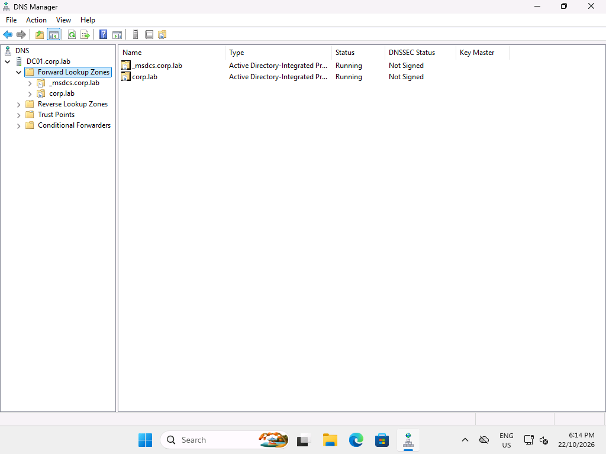

# CLIENT01 evidence

Actual Windows 11 Enterprise Evaluation guest outputs, 22 October 2026, Australia/Sydney. First-boot/setup files are historical; final checks establish completion.

## Final verification

- [Six standard-user checks passed](client-staff-acceptance.json); [Pester transcript](FinalChecks-transcript.txt).
- [User state](FinalChecks-state.json): actual CORP\alex.morgan, Finance/own home allowed, HR/another home denied, Finance/home maps, restriction and printer present.
- [User gpresult text](FinalChecks-gpresult.txt) / [HTML](FinalChecks-gpresult.html); [group token](FinalChecks-groups.txt).
- [Computer settings](client-computer-check.json), [computer gpresult](gpresult-computer.txt) / [HTML](gpresult-computer.html): membership, SMB signing, LLMNR off and update configuration.
- [Evaluation activation/expiry](evaluation-activation.txt). No key or password included.
- [One-use guest logon cleanup](single-use-logon-cleanup.json): automatic logon disabled, private LSA secret removed, no plaintext password present. CLIENT01 only.

## RSAT

Native capability checks: [AD tools](rsat-ActiveDirectory-native.txt), [Group Policy](rsat-GroupPolicy-native.txt), [DNS](rsat-Dns-native.txt). Screenshots are actual consoles on CLIENT01.

## Demo

59.62 seconds, 119 original framebuffer captures, original timing preserved. [Manifest](demo-recording.json) lists source frame timestamps and SHA256 values; original frames remain private. Encoding quantises colours and rounds timing to GIF precision; the exercise is not accelerated.

[DC01 onboarding output](../server/demo-onboarding.txt) records zero matching accounts before creation, demo.onboard enabled, Finance membership, private home, reserved mail attribute and required initial password change. [Client transcript](Demo-transcript.txt), [state](Demo-state.json) and [gpresult](Demo-gpresult.txt) show the real directory query and policy refresh. The new account and existing policy user Alex are identified separately.

## Ticket screenshots

The [five runbooks](../../README.md#five-support-tickets) link images to raw results. Recorded-review images explicitly show saved results on CLIENT01; they are not current fault screens. Actual fault screenshots are also included for mapping and GPO exercises and the share repair.

A historical printer preference refresh reported 0x8007000a. Subsequent refreshes, the demo and final acceptance show the shared connection. No Point and Print security bypass was used; the transient error's underlying cause is unresolved.

[SHA256 manifest](sha256.csv) hashes committed evidence bytes. UTF-16 text outputs were transcoded to UTF-8 for browser readability without changing result text. Three transcript Host Application headers explicitly redact PowerShell Direct transport metadata; diagnostic outcomes are unchanged.
